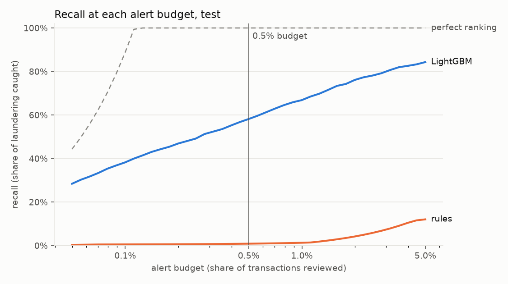
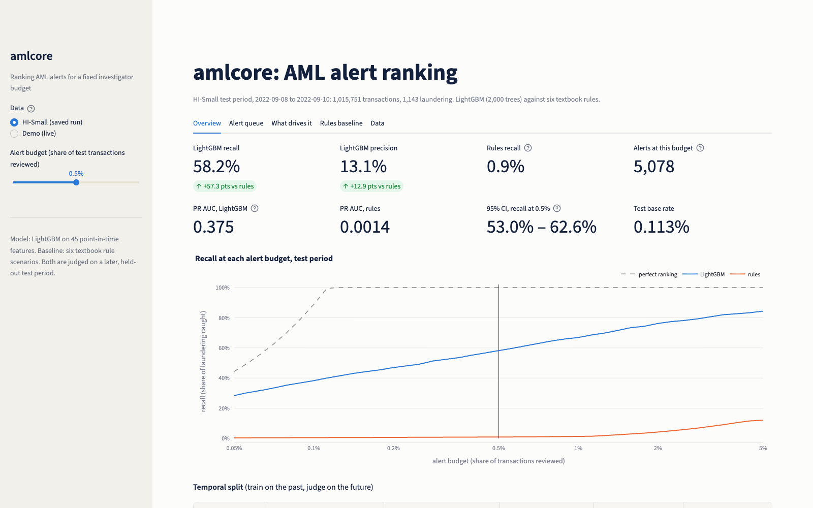
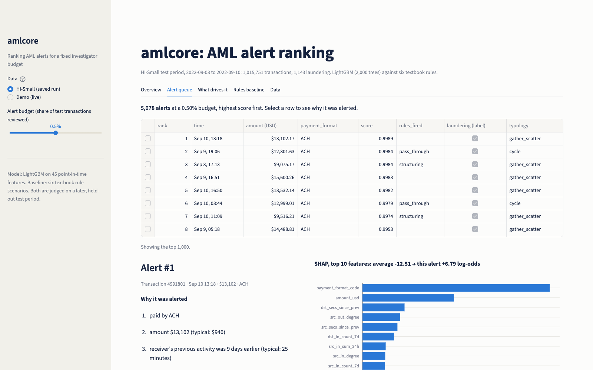

# amlcore: ranking AML alerts for a fixed investigator budget

A bank's investigators can review only a small share of payments each day. This project
turns transactions into a **ranked alert list** and asks one question: **of all the
laundering, how much lands in the top 0.5% of the list?** It compares a textbook
rules-based monitoring system with a LightGBM model on IBM's synthetic AMLworld data
(HI-Small: 5 million transactions over 10 days, 0.09% laundering). Both use the same
leak-free, point-in-time features, and both are judged on a later, held-out period.

## Results (test: Sep 8–10, 1,015,751 transactions, 0.113% laundering)

At a 0.5% alert budget (5,078 alerts), mean of 5 seeds:

| | Recall | 95% CI | Precision | PR-AUC | Account recall | Account precision |
|---|---|---|---|---|---|---|
| Rules (6 textbook scenarios) | 0.9% | 0.5–1.3% | 0.20% | 0.0014 | 4.7% | 3.6% |
| **LightGBM (45 point-in-time features)** | **58.3%** | 53.3–62.7% | **13.1%** | **0.369** | 40.2% | 31.2% |

- **Against the rules:** with the same number of alerts, the model catches about 65× as
  much laundering. About 1 alert in 8 is real, against 1 in 500 for the rules.
- **Against the ceiling:** with 1,143 laundering payments and 5,078 alerts, the best
  precision any ranking could reach is 22.5%.
- **Reproduced by this repository:** `python -m amlcore.cli run` gives the seed-42 run,
  58.2% recall [53.0%, 62.6%] and PR-AUC 0.375.



**What the model gets right, and where it doesn't.**
- **Documented schemes:** 69–90% of each typology is caught (fan-in, cycles,
  scatter-gather, ...).
- **Unattributed laundering:** only 18% is caught. These rows belong to no documented
  scheme and are 40% of test positives. That's the honest weak spot.
- **Reason codes:** read in bulk, the per-alert reasons show the model leans hard on
  payment format. "Paid by ACH" is the first reason on 99% of alerts
  ([talking point 6](docs/talking_points.md#6-reason-codes-showed-the-model-mostly-asks-is-it-ach)).

## How it works

```
raw CSV + Patterns file
   │  data.py      cut the simulator's tail, sort, account ids, USD, typology, temporal split
   ▼
transactions (5,077,237 rows; 60% train / 20% val / 20% test by time)
   │  features.py  45 features, each from strictly earlier payments only
   ▼
feature table ──► rules.py   six scenarios → weighted rule score  ─┐
              └─► model.py   LightGBM, early stopping on val AP   ─┤
                                                                  ▼
                  metrics.py  recall / precision at budget, PR-AUC, block-bootstrap CI
                  explain.py  TreeSHAP → top-3 reasons per alert, plus the rules that fired
```

**The features** (what an account did before this payment, never after):

| Group | Count | Examples |
|---|---|---|
| Transaction | 11 | USD amount, payment format, currencies, cross-bank, round amount, hour |
| Account history | 28 | sender's and receiver's payment counts and sums over 1h / 24h / 7d, time since previous activity, account age (capped at 48h) |
| Derived | 2 | pass-through ratio (pays out what just came in), outflow burst |
| Graph degree | 4 | distinct counterparties each account had met before |

## Ground rules

1. **Point-in-time features only.** A feature at time t uses transactions strictly
   before t, with windows `[t − w, t)`. Same-minute payments never see each other.
   Two tests prove it ([talking point 2](docs/talking_points.md#2-point-in-time-features-and-the-tests-that-prove-them)).
2. **Temporal split, never random. Never tune on test.** Test was scored only for the
   finalists, once each.
3. **Headline metrics are recall and precision at an alert budget, plus PR-AUC.** Never
   accuracy: flagging nothing is 99.9% accurate.
4. **Every module has tests.** The suite runs in seconds on bundled synthetic data.
5. **Every judgement call is written down**, with its evidence and its cost, in
   [docs/talking_points.md](docs/talking_points.md).

## Quickstart

Needs Python 3.12 or later.

```bash
python3 -m venv .venv && source .venv/bin/activate
pip install -e '.[dev]'

python -m pytest                          # 100 tests, about 5 seconds
python -m amlcore.cli run --demo          # whole pipeline on bundled synthetic data, seconds
```

On the real data (HI-Small, about 475 MB, from Kaggle; the script needs the Kaggle CLI
and an API token in `~/.kaggle/`):

```bash
pip install kaggle
scripts/download_data.sh HI-Small
python -m amlcore.cli run                 # features ~1 min, training ~5 min on a laptop
```

Outputs go to `reports/HI-Small/`:
- `report.md`: data summary, headline, every budget, typology recall, SHAP summary
- `metrics.json`: every number
- `alerts_test.csv`: the alert queue, each alert with three reasons and the rules that fired
- the two charts

## Dashboard

A local Streamlit app for showing the model live: metrics at any alert budget, the alert
queue with per-alert SHAP explanations, what drives the score, the rules baseline, and
the data.

```bash
pip install -e '.[app]'
streamlit run app/dashboard.py            # opens http://localhost:8501
```

It has two modes, switched in the sidebar:
- **Saved run:** the HI-Small results that `python -m amlcore.cli run` wrote.
- **Demo (live):** one click trains on the bundled synthetic data in seconds. The
  numbers are toy-sized.





The tabs:

| Tab | What it shows |
|---|---|
| Overview | recall, precision and alerts for model and rules at the chosen budget; PR-AUC, the 95% interval, the recall-vs-budget curve |
| Alert queue | the top-k alerts; select one to see its three reasons, the rules that fired and a SHAP chart of its top features |
| What drives it | global SHAP importance, most common first reasons, recall by payment format and by typology |
| Rules baseline | each rule's firing rate, precision when fired and share of laundering flagged |
| Data | daily volume and laundering rate by split |

The app only reads a run's saved outputs, so it opens in seconds even on 5 million
transactions. Its logic is in `src/amlcore/showcase.py`, which is tested; the app's
rendering is checked with Streamlit's `AppTest`.

## Documentation

- **[docs/WALKTHROUGH.md](docs/WALKTHROUGH.md):** the project as a 10-minute story, from
  problem to limitations.
- **[docs/talking_points.md](docs/talking_points.md):** eight judgement calls, each with
  what I noticed, the evidence, the decision and its cost.
- **[docs/experiments.md](docs/experiments.md):** how the configuration was chosen:
  - the feature ladder, model families and imbalance handling
  - the finalists on test, over 5 seeds
  - why the runner-up wasn't picked

## Repository layout

```
configs/default.yaml   every setting, with why: tail cut, split, windows, rules, tuned model
data/demo/raw/         small synthetic dataset in AMLworld's format (for tests and the demo)
scripts/               data download
src/amlcore/           config, data, features, rules, model, metrics, explain, pipeline, charts, cli,
                       showcase (the dashboard's data logic)
app/dashboard.py       the Streamlit dashboard
tests/                 one test file per module, plus an end-to-end run
docs/                  walkthrough, talking points, experiment record, figures
```

## Limitations and next steps

- **Synthetic data, one simulator.**
  - Simulated laundering is mostly ACH, so the model leans on payment format.
  - A model trained on HI-Small ranks the lower-prevalence LI-Small nearly as well as a
    model trained on LI-Small itself (34% against 37–38% recall at 0.5%). But its score
    threshold doesn't carry over: a threshold set for 0.5% of payments flags 0.72% there.
- **Short history.** Training covers 5.5 days, so 7-day windows are never full in training.
  Account age was capped for this reason; the 7-day windows have the same issue, more
  mildly.
- **What production would add:**
  - **Online scoring** from the same feature code, with a replay test that streamed
    payments get the same features as the batch run.
  - **Daily drift and alert-rate monitoring.** Weekend queues run at about twice the
    budget under a fixed threshold, so the queue should take the top 0.5% per day.
  - **Alert-rate checks by payment format, currency and bank.**
  - **Recall reported for new versus continuing schemes.**
- **Model ideas worth testing on fresh data:**
  - **Windowed counterparty counts:** the runner-up feature set, which won on test.
  - **A graph neural network,** compared on this same split.

## Data

IBM Transactions for Anti-Money Laundering (AMLworld), Altman et al., *Realistic Synthetic
Financial Transactions for Anti-Money Laundering Models*, NeurIPS 2023 Datasets and
Benchmarks. Downloaded from Kaggle (`ealtman2019/ibm-transactions-for-anti-money-laundering-aml`).
The data is synthetic: no real customers are involved.
