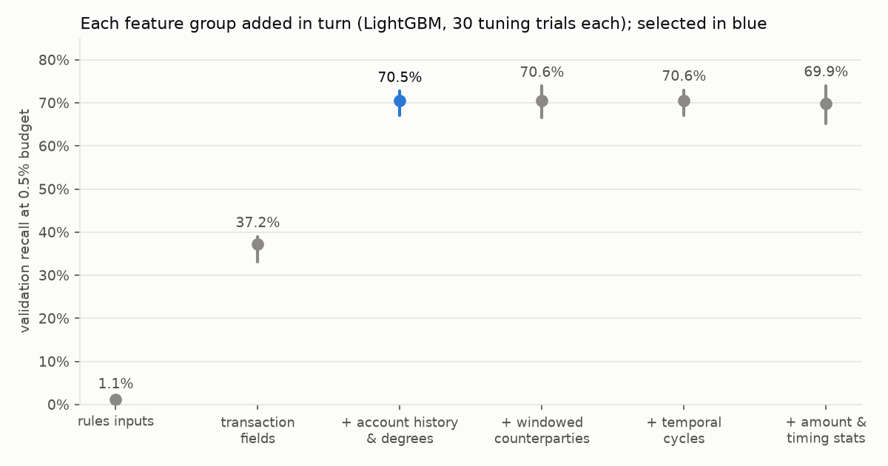

# Experiment record

How the shipped configuration (`configs/default.yaml`) was chosen. The search harness
behind these runs was Optuna plus a runner that logged every run. It isn't part of this
repository, to keep it small, so this page is the record of what it found. Everything
the final model needs is here and runs with `python -m amlcore.cli run`.

## Protocol, fixed before any result

- **Data and split:** HI-Small, cut at 2022-09-11. The split is temporal: 60% of
  transactions train, 20% validation, 20% test.
- **Tuning:** validation only. Each approach got the same Optuna budget, maximising
  validation recall at the 0.5% budget: 30 trials for the feature ladder, and 15 for
  model families and imbalance handling.
- **Uncertainty:** 95% intervals from a block bootstrap of validation, resampling whole
  6-hour blocks (1,000 resamples).
- **Selection rule:** take the highest validation recall. Any approach inside its
  interval counts as a tie, and the tie goes to the simpler one.
- **Constraints:** p99 scoring latency under 100 ms per 1,000 transactions, and
  per-alert explanations available.
- **Test:** scored only for the finalists, once, over 5 seeds.

## Feature ladder: LightGBM, adding one feature group at a time

| Set | Adds | Features | Val recall @ 0.5% | 95% CI | PR-AUC |
|---|---|---|---|---|---|
| A0 | rules inputs only | 6 | 1.1% | 0.7–1.6 | 0.001 |
| A1 | raw transaction fields | 11 | 37.2% | 33.1–39.0 | 0.068 |
| **A2** | **point-in-time account history + degrees** | **45** | **70.5%** | 67.1–72.7 | 0.477 |
| A3 | + windowed distinct counterparties | 57 | 70.6% | 66.6–73.9 | 0.496 |
| A4 | + 2–4 hop temporal cycles, scatter/gather | 67 | 70.6% | 67.0–73.0 | 0.502 |
| A5 | + amount and timing statistics | 139 | 69.9% | 65.2–74.0 | 0.509 |

- **Where the gain is:** almost all of it is A1 → A2. That step adds what each account
  did before this payment.
- **The graph groups (A3–A5):** they raise PR-AUC, so they improve the ranking further
  down the list. They don't change recall within a 0.5% budget.
- **Selection:** A2 is inside A3's interval and simpler, so the rule picks A2.

## Model families, on A2

| Model | Val recall @ 0.5% | 95% CI | PR-AUC |
|---|---|---|---|
| Rules | 1.1% | 0.7–1.6 | 0.001 |
| Isolation Forest (unsupervised) | 0.6% | 0.3–1.1 | 0.002 |
| Logistic regression | 40.7% | 37.4–43.3 | 0.090 |
| Random forest | 64.5% | 61.5–66.9 | 0.325 |
| XGBoost | 70.0% | 65.7–72.9 | 0.490 |
| LightGBM | 69.5% | 66.6–72.3 | 0.464 |

- **The two boosted-tree families** are indistinguishable.
- **The linear model** trails by about 30 points: the signal is in thresholds and
  interactions.
- **Anomaly detection is below the rules.** Laundering payments look normal one at a
  time; the pattern across accounts and time needs labels.

## Imbalance handling, on XGBoost / A2

| Setting | Val recall @ 0.5% | PR-AUC |
|---|---|---|
| **None** | **70.0%** | **0.490** |
| √(neg/pos) weighting | 68.9% | 0.461 |
| Balanced weighting | 68.4% | 0.470 |
| Undersample to 1:100 | 68.7% | 0.442 |
| SMOTE to 1:100 | 68.7% | 0.463 |

None of the settings helps, and every one lowers PR-AUC. Reweighting mostly changes
calibration, which a ranking judged at a fixed budget doesn't reward
([talking point 4](talking_points.md#4-class-weighting-broke-the-model)).

## Finalists on test (5 seeds each, mean)

| Finalist | Recall @ 0.5% | 95% CI | Precision | PR-AUC | Account recall | Account precision |
|---|---|---|---|---|---|---|
| Rules | 0.9% | 0.5–1.3 | 0.20% | 0.0014 | 4.7% | 3.6% |
| A2 (selected) | 58.5% | 53.5–62.8 | 13.2% | 0.370 | 41.4% | 32.2% |
| A3 (runner-up) | 61.7% | 57.0–65.9 | 13.9% | 0.406 | 44.1% | 34.2% |
| **A2, account age capped (shipped)** | **58.3%** | 53.3–62.7 | **13.1%** | **0.369** | 40.2% | 31.2% |

- **The runner-up won on test.** A3 beat A2 by 2.4–4.5 points in every seed, with
  paired intervals excluding zero. The choice stayed with A2, because switching after
  seeing test turns test into validation
  ([talking point 8](talking_points.md#8-the-runner-up-beat-the-winner-on-test-and-i-didnt-switch)).
- **The account-age fix** came from drift monitoring after the decision
  ([talking point 7](talking_points.md#7-account-age-drifted-by-construction-so-it-was-capped)).
  It was adopted on validation by a rule written before the run: 69.1%, against a floor
  of 67.1%. On test it is level with A2: the paired difference is −1.2 to +0.8 points
  per seed, and every interval contains zero.
- **Seed spread:** for the shipped model, test recall is 57.6–59.3% across seeds. The
  seed-42 run this repository reproduces gives 58.2% [53.0%, 62.6%] and PR-AUC 0.375.
- **Tuning matters:** before tuning, the same 45 features gave 43.2% test recall and
  PR-AUC 0.185. Only the hyperparameters changed.

## Ideas that didn't help (validation, A2's tuned parameters, seed 42)

| Change | Val recall @ 0.5% | PR-AUC |
|---|---|---|
| A2 as selected | 70.5% | 0.477 |
| + Isolation Forest score as an input | 70.3% | 0.486 |
| + counterparties first met within each window | 70.7% | 0.509 |
| Rules with thresholds and weights fitted on train | 1.8% | 0.001 |

## Known limitations

- **Validation is optimistic.** It was both tuned on and used for early stopping: 70.5%
  on validation became 58% on test, at nearly the same base rate. Test is the number to
  quote.
- **The tree cap binds.** With the tuned learning rate (0.016), early stopping didn't
  trigger before the 2,000-tree cap. The cap was part of the tuned setup.
- **Schemes outlive the split cuts.** AMLworld schemes run for 1–6 days, and the split
  periods are about 2 days, so about 60% of documented laundering in test belongs to
  schemes that started before test did. Recall by typology is partly "recognise a scheme
  already seen starting". Unattributed laundering (40% of test positives, 18% recall)
  has no scheme to continue, so its recall is the honest floor.
- **One dataset, one simulator.** The model leans on payment format, because simulated
  laundering is mostly ACH. A ranking trained here transfers to a lower-prevalence
  variant, but the score threshold doesn't: set thresholds by alert volume per portfolio.
- **Short history.** Training spans 5.5 days, so the 7-day windows are never full in
  training. Account age was fixed for this; the 7-day windows and cumulative degrees
  have the same issue, more mildly.
